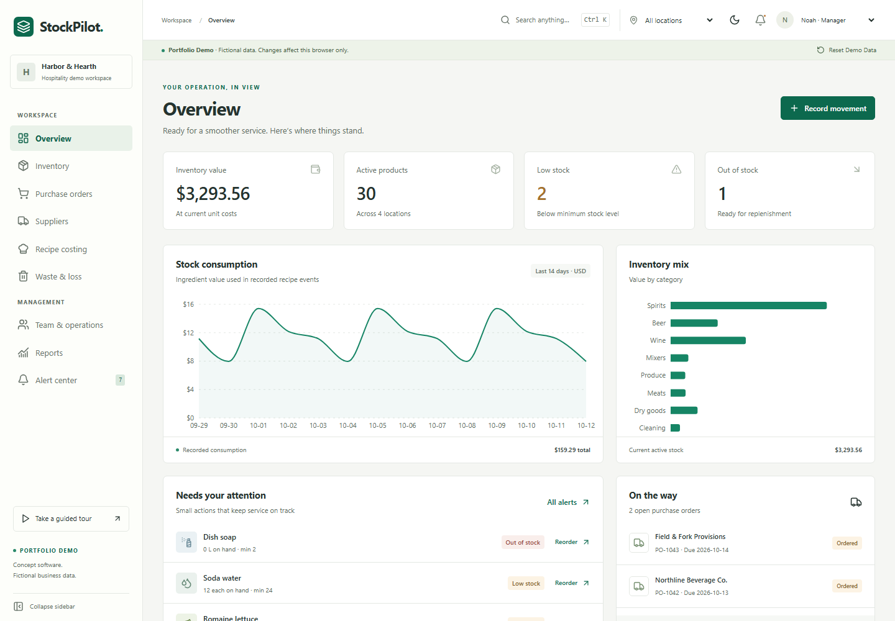

# StockPilot

**Know your stock. Control your costs.**

A working hospitality inventory and operations concept, built for a digital agency portfolio. Demo #3 uses a restrained emerald, off-white, and charcoal SaaS workspace, distinct from a restaurant website or service-business landing page.

- **Public site:** https://stockpilot-demo.pages.dev
- **Interactive application:** https://stockpilot-demo.pages.dev/app
- **Source:** https://github.com/rwesterngeorgia-glitch/Demo3

This is a concept/prototype, not software connected to an operating business. All suppliers, staff, inventory, and activity are fictional. Changes affect only the current browser. No signup, supplier messages, payments, paid APIs, or real authentication.



## What works

| Area | Behavior |
| --- | --- |
| Overview | Current inventory value, active products, low/out-of-stock counts, recorded consumption, purchase deliveries, recent movements, category valuation, and waste |
| Inventory | Create, edit, archive, search, sort, filter, CSV export, supplier assignment, base units, case sizes, bottle volumes, location balances |
| Audit ledger | Incoming stock, signed adjustments, paired transfers, physical-count reconciliation, waste, recipe consumption, before/after balances, actor labels, timestamps, transaction groups |
| Purchasing | Multi-line orders, drafts, placement, cancellation, partial receipts, remaining balances, receipt replay protection, over-receipt prevention, historical invoice costs |
| Recipes | Six cocktail/food/coffee recipes, creation/editing, dimension-checked conversions, ingredient breakdowns, theoretical profit/margin/target costs, production consumption |
| Waste | Damaged/expired/spillage/spoilage/other loss entries, stock reductions, event-cost valuation, category and time charts, filters, CSV |
| Operations | Four fictional role labels, opening/closing checklists, counting assignments, completion, persistent announcements |
| Reports | Category valuation, low stock, supplier purchases, waste, movement history, recipe costs, event-derived consumption, location/category/supplier/date filters |
| Alerts | Low/out-of-stock items, open deliveries, incomplete tasks, explicit high-waste threshold, simple reorder quantities |
| Demo experience | Interactive non-blocking tour, real workflow completion advances, reset, browser isolation, light/dark themes, collapsible/mobile navigation, Ctrl/Cmd K search |

### Units, valuation, and transaction rules

Each product has one fixed canonical base unit: **bottle**, **kg**, **L**, or **each**. Cases convert using that product’s pack size. Recipe milliliters convert to bottle equivalents using the item’s bottle volume; grams convert to kilograms; milliliters convert to liters. Incompatible dimensions are rejected. Existing base unit, volume, and pack definitions are immutable to preserve the meaning of historical records. Create a new item for a different package definition.

Current inventory valuation uses the current catalog unit cost (standard cost), including recipe recalculation. Ledger and waste valuations use the cost captured when an event occurred. Purchase receipts retain their invoice cost in the ledger; they do not automatically change catalog standard cost. This prototype does not implement FIFO, weighted-average, tax, freight, or landed-cost accounting.

Every stock action is applied to a cloned state and either commits fully or throws without changing the original. Transfers contain equal source/destination entries sharing a transaction group. Counts set the location balance to the measured quantity and log the difference. Production consumes all ingredients atomically. Negative stock is rejected.

Receiving accepts **this delivery’s quantity**, bounded by the outstanding balance. A unique receipt ID cannot be replayed. Once all expected units arrive the order becomes Received and no longer accepts deliveries. A later legitimate partial delivery has its own ID; the app cannot distinguish physical deliveries solely from identical quantities, so staff must enter each delivery accurately.

Archived items retain stock and audit history. The active catalog/dashboard exclude them; valuation reports include them with an Archived column. Existing recipes can still be costed, while further stock actions and receipt/production use of archived products are rejected until those workflows are updated.

### Explicit alert rules

- Low stock: current quantity below the configured minimum, evaluated at the selected location or company total.
- Out of stock: current quantity equals zero.
- Reorder: `max(0, 2 × minimum − current stock − outstanding ordered quantity)`, scoped to the location.
- High waste: more than **$25** in recorded losses in the last **7 local calendar days**.
- Delivery alerts: open Ordered/Partially received purchase orders show their expected date.
- Incomplete task alerts: any unchecked sample checklist task.

There are no predictive AI claims. Consumption means recorded stock usage, not sales. All recipe profitability is theoretical and excludes labor, overhead, tax, and actual sales data.

## Local development

Node.js 22.12+ (tested with Node 24) and npm:

```sh
npm ci
npm run dev -- --port 5174
```

```sh
npm run lint
npm run typecheck
npm test
npm run build
npx playwright install chromium
npm run test:browser
```

Browser tests expect a running application at `http://127.0.0.1:5174`. Set `BASE_URL` to test another origin, including the deployment. PowerShell:

```powershell
$env:BASE_URL='https://stockpilot-demo.pages.dev'
npm run test:browser
```

Test outcomes and scope are recorded in [QA.md](QA.md).

## Architecture and persistence

React + Vite + TypeScript + Tailwind CSS, React Router, Lucide icons, Recharts. Native dialogs, semantic form labels, keyboard access, and reduced-motion support provide accessible interactions. Charts render actual domain records. React and chart libraries are split into separate build chunks.

| Module | Responsibility |
| --- | --- |
| `src/types.ts` | Domain models and typed commands |
| `src/domain.ts` | Pure atomic commands, invariant checks, conversions, costing, CSV serialization |
| `src/seed.ts` | Relative-date fictional seed, 30 items, four locations, six recipes, recorded event history |
| `src/store.tsx` | Versioned browser-local storage adapter and command dispatch |
| `src/Inventory.tsx`, `Purchasing.tsx`, `Recipes.tsx` | Workflow forms and screens |
| `src/Analytics.tsx` | Computed overview, reports, waste, and alerts |
| `src/GuidedTour.tsx` | Non-blocking guide with actual workflow completion |
| `src/Operations.tsx` | Fictional tasks/staff/announcements |
| `src/Landing.tsx`, `App.tsx`, `style.css` | Public portfolio page, workspace shell, responsive design |

The localStorage key is `stockpilot-demo-v1`, with `version: 1` in the stored state. No state is sent to a server. A successful change writes the whole validated state and persists across refreshes. Reset regenerates the sample records. Unknown schemas and invalid saved JSON produce a visible recovery message. Storage quota/permission failures show an explicit warning while allowing in-memory use. Clearing browser storage removes changes. Concurrent tabs use last-writer storage behavior; this is not multi-user concurrency control.

All demo roles are actor labels only. They confer no authentication or enforced authorization. All application routes are intentionally public. No sensitive or employee data should be entered.

## Cloudflare Pages

The static output directory is **dist**. There is no server runtime. Pages’ SPA fallback handles `/app` and nested route refreshes; do not add a top-level `404.html`. Security headers are in `public/_headers`.

```sh
npx wrangler login
npm run build
npx wrangler pages project create stockpilot-demo --production-branch main --force
npx wrangler pages deploy dist --project-name stockpilot-demo --branch main
```

Create the project once. Wrangler 4.149 required `--force` at initial project creation to select Cloudflare Pages instead of its new Workers delegation. Subsequent deployments use the existing Pages project without that flag. The project uses direct upload, with no automatic GitHub deployment hook. Redeploy after source changes. Never commit credentials; Wrangler OAuth lives outside the repository.

## Portfolio materials

See [marketing/README.md](marketing/README.md) for actual app screenshots, six 1080 × 1350 carousel PNGs, Reel storyboard, Facebook post draft, and short case study. Marketing identifies this as a concept/prototype. Social posts are drafts and have not been published.

With the local app running:

```sh
node scripts/capture.mjs
node scripts/marketing.mjs
```

The public landing page embeds copies of actual dashboard and recipe screenshots. These are clearly previews; live interaction is at `/app`.

## Adapt into real customer software

1. Move typed command processing behind an authenticated API. Keep server-side validations, scoped product queries, transactional stock/receipt writes, unique receipt constraints, optimistic concurrency, and immutable append-only audits. Never trust client roles or submitted balances.
2. Introduce a tenant-scoped relational database with migrations, per-location permissions, secure identity, session management, and strict authorization for every operation. Replace localStorage with server reads and commands. Add backups and tested recovery.
3. Agree on physical units and costing policies with the customer. Add supplier catalogs, tax/freight/landed costs, FIFO or weighted average, lots, expiry dates, stock count sessions, approval workflows, and accounting integrations where needed.
4. Validate recipes, yields, portion rounding, allergens, production, modifiers, and actual POS sales integration. Treat theoretical margins separately from realized profit.
5. Replace fictional data with approved customer content. Add privacy/retention controls before employee or supplier personal data, audit actor identities, and restrict who can archive, receive, count, or adjust stock.
6. Add integration idempotency, retry behavior, observability, monitoring, rate limits, performance budgets, extensive concurrency/security testing, and an independent accessibility review. Deploy staging first and verify realistic customer workflows before production.

This demo is a starting point for requirements and engineering discussion, not production-ready inventory or financial accounting software.
